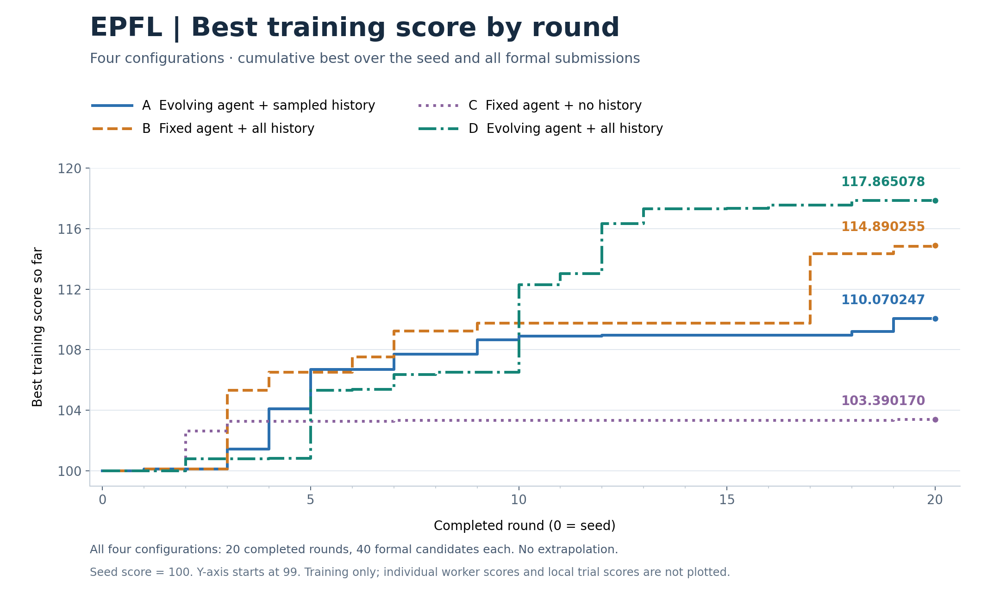
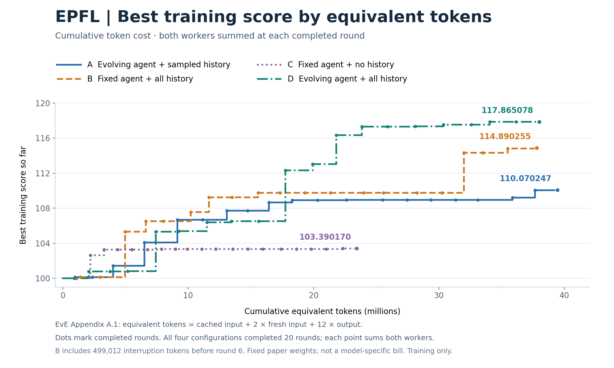

# EPFL：agent 演化与执行历史的四组对比

四组20轮实验 · 2026年10月11日 · [English](comparison.en.md) · [运行说明](../README.md) · [Seed 与各组最佳配方](../recipes/README.md)

## 问题设定（Problem setup）

### 任务与搜索空间

我们在EPFL基准的选定电路子集上，搜索一份 **ABC逻辑综合配方，在保持电路功能等价、满足固定延迟上限的条件下，降低映射后的标准单元面积**。输入是AIG格式的电路；一个候选是JSON文件，包含一份有序的 **1–40条综合命令列表**。同一列表原样作用于所有split中的每个电路，不按电路单独选择配方或设置分支。

搜索可以调整 `balance`、`rewrite`、`refactor`、`resub` 的顺序、重复次数和白名单选项，包括允许的 `-z` 变体及resubstitution的 `-K 6/8/10/12/16`。输入读取、技术映射（`map`）、测量和等价性检查由评测器固定，使用ABC与Nangate45单元库。面积和延迟是逻辑综合及技术映射后的测量值，本实验不涉及物理布局布线。四组共用同一份[搜索空间与评分规则](../examples/epfl_synthesis/protocol.py)和[评测器](../examples/epfl_synthesis/evaluate.py)。

### 数据划分、基线与目标

| Split | 电路 | 用途 |
| --- | --- | --- |
| Training | adder、bar、max、arbiter、i2c、priority | 搜索过程反馈及正式候选排名 |
| Validation | sin、cavlc、dec | 评测已锁定的最终训练赢家 |
| Test | square、multiplier、voter | 评测同一个已锁定赢家 |

每组从相同的十条命令 `resyn2` seed配方和初始agent guidance出发。每个电路的冻结 `resyn2` 结果同时提供基准面积和延迟上限。候选必须通过组合逻辑等价性检查（CEC），取得有效有限的面积/延迟指标，并满足该电路的延迟cap。综合、在新ABC进程中测量、等价性检查及接受结果共享 **每电路30秒、单线程** 墙钟预算。

对于被评测电路集合C，若配方P全部可行，得分为：

`score_C(P) = (100 / |C|) × 对C中各电路求和(resyn2面积 / 候选面积)`。

**任意一个**电路未证明等价、超时、测量无效或超过延迟cap，**整个集合得0**。因此training取六个面积比值的均值，每个保留split取三个；`resyn2`为100分，越高越好。由于目标平均的是面积比值的倒数，增加10分不等于面积降低10%。

### 搜索与评测流程

每组 **20轮 × 每轮2个worker串行**，使用gpt-6-astra/xhigh，每次rollout最多 **24 turns、1,200秒**。worker获得最多四份过去的solver配方及正式反馈，以及由组别决定的guidance和历史参考；在optimize内最多进行 **三次覆盖全部六个训练电路的完整评测**，看过测量后继续修改，再选择提交配方。worker结束后，框架对提交配方再做一次正式训练评测。同轮两名worker的输入在轮前选定，第二人看不到第一人本轮的新结果。

四十个完成worker因此最多执行 **120次本地完整训练评测**，另有 **40次正式候选评测与1次seed正式评测**。这里“training”指搜索反馈所用的电路，语言模型权重始终固定；演化的是配方，以及A/D组中的agent guidance。本地完整评分在提交前就可见，正是保存optimize日志对后续worker可能很有价值的原因。

最终配方只按正式训练最高分选择，包含seed，同分取最早生成；先锁定配方，再评测validation/test，结果不用于继续搜索。与此前已测配方相同时复用保留集结果，包括失败；新赢家的每个保留split只测一次。两套保留集都是设计者已见对照集。四组在这一共同任务与预算下比较guidance演化和历史访问方式，具体区别见后文配置表。

## 结果

四组均完成20轮、40个正式候选。**D取得最高训练分117.865078**，B、A、C分别为
114.890255、110.070247、103.390170。B的test仍略高于D：102.447260与102.175127。
每个配置各运行一次。

这里的 **agent** 指EvE代码中的 `optimizer` guidance；**worker** 指一次rollout：

- **A: Evolving agent + sampled history**
- **B: Fixed agent + all history**
- **C: Fixed agent + no history**
- **D: Evolving agent + all history**

| 指标 | A: Evolving agent + sampled history | B: Fixed agent + all history | C: Fixed agent + no history | D: Evolving agent + all history |
| --- | --- | --- | --- | --- |
| 完成轮次 | 20/20 | 20/20 | 20/20 | 20/20 |
| 第5轮累计训练最佳 | 106.682500 | 106.526298 | 103.262182 | 105.331594 |
| 第20轮累计训练最佳 | 110.070247 | 114.890255 | 103.390170 | **117.865078** |
| 第5→20轮得分增量 | +3.387747 | +8.363957 | +0.127988 | **+12.533484** |
| 五轮赢家：validation / test | 0 / 102.656734 | 0 / 102.656734 | 未测 / 未测 | 未测 / 未测 |
| 最终赢家：validation / test | 0 / 0 | 0 / 102.447260 | 0 / 0 | 0 / 102.175127 |
| 最终训练赢家：逐电路平均面积降幅 | 7.6324% | 11.0924% | 3.0516% | 11.6349% |
| 最终训练赢家：总面积降幅 | 3.3494% | 4.6092% | 1.1400% | 4.3502% |

训练分平均的是面积比值的倒数。逐电路平均面积降幅为
`mean(100 × (1 − 候选面积 / 基准面积))`；总面积降幅按各电路面积之和计算。
得分增量与面积降幅是不同指标。

## 训练曲线

[矢量SVG](figures/training-trajectories.svg)。每条曲线取seed及截至该轮两名worker
全部正式提交分数的最大值。第0轮为100分seed，纵轴从99开始；图中只画training。

[矢量SVG](figures/training-vs-equivalent-tokens.svg)。每个点对应一轮完成，横轴累计
两名worker的用量。等效方式沿用[EvE附录A.1](https://arxiv.org/html/2605.09018v4#A1)：

`等效token = cache + 2 × fresh input + 12 × output = 2 × input − cache + 12 × output`

native input已经包含cache，output已经包含reasoning。该公式是论文的统一比较尺度，
并非模型实际价格；ABC计算单独计量。

| 曲线终点的等效token成本 | A：20轮 | B：20轮 | C：20轮 | D：20轮 |
| --- | ---: | ---: | ---: | ---: |
| 完成worker，按轮合计 | 39,438,854 | 37,304,414 | 23,446,352 | 37,986,238 |
| 保留的中断尝试 | 0 | 499,012 | 0 | 0 |
| 图中累计成本 | **39,438,854** | **37,803,426** | **23,446,352** | **37,986,238** |

计数取每个session最后的累计native usage，再跨session和worker求和，不重复加入
optimizer CSV用量。B在第5轮后停止的一次尝试折合499,012等效token，计入第6轮成本一次，
不产生候选或分数。C更早被取消并删除的尝试不属于图中这次run，其不可得成本不视为零。

## 四组配置区别

下列字段都在 `loop` 下。配置文件分别为[A](../configs/eve/epfl_A.yaml)、
[B](../configs/eve/epfl_B.yaml)、[C](../configs/eve/epfl_C.yaml)、
[D](../configs/eve/epfl_D.yaml)，共用[运行设置](../configs/eve/epfl_common.yaml)和
[采样配置](../configs/eve/loop/epfl_synthesis.yaml)。

| 配置 | A: Evolving agent + sampled history | B: Fixed agent + all history | C: Fixed agent + no history | D: Evolving agent + all history |
| --- | --- | --- | --- | --- |
| `produce_optimizer_in_phase2` | 2 | 0 | 0 | **2** |
| `n_optimizer_examples_phase2` | 4 | 4 | 0 | **100** |
| `optimizer_log_inheritance` | current | current | none | **none** |
| Optimizer参考sampler | `PerWorkerExcludeAllWorkingSampler` | 同A | 同A，但不提供参考 | **`PerWorkerExcludeSelfSampler`** |
| `n_solver_examples_phase2` | 4 | 4 | 4 | 4 |
| `n_workers_phase2` / `n_parallel_phase2` | 2 / 1 | 2 / 1 | 2 / 1 | 2 / 1 |
| `max_iterations` （目标） | 20 | 20 | 20 | 20 |

`produce_optimizer_in_phase2` 决定编辑后的guidance是否进入agent人口。为0时人口只有
原始seed，即使worker修改本地guidance也不会把它传给后续worker；为2时每轮最多接纳
两份实际发生修改的guidance。

`n_optimizer_examples_phase2` 决定提供给worker的参考。4包含自身agent和最多三份
抽样参考，每份都有guidance、logs和score。B只有一个agent，提供一次但携带累计日志；
C设为0后不提供参考目录，包括自身agent的历史，但保留工作guidance与solver参考。

`optimizer_log_inheritance=current` 让新agent出生时带上产生它的那次执行日志，
不复制父条目的完整旧历史；`none` 让新agent从空日志开始。两种设置下，完成的执行
都会追加到实际使用的agent上。新条目如何继承，与worker能访问哪些参考，是两件事。

D使用 `PerWorkerExcludeSelfSampler`，只排除自身agent，再由EvE补回自身。A的sampler
排除同轮全部working agents，因此单纯提高参考数量仍可能遗漏另一个worker的agent。
D的人口最多41个，100的上限足以覆盖全部；收集所有条目便能从各自所有者访问此前
完整执行历史，无须复制到新条目中。D同时提供全部guidance文本，因此变化也包含
guidance覆盖范围。

实现见公开EvE的[参考sampler](https://github.com/scaling-group/eve/blob/main/src/scaling_evolve/algorithms/eve/populations/samplers/optimizer_examples.py)
和[Phase 2流程](https://github.com/scaling-group/eve/blob/main/src/scaling_evolve/algorithms/eve/workflow/phase2.py)。

## 为什么这里的执行历史特别有用

**EPFL允许worker在optimize内取得完整训练得分，然后继续修改配方。** 一次rollout
最多执行三次覆盖六个训练电路的完整评测，查看面积、延迟、等价性后选择提交。
rollout结束后，框架再对提交结果正式评测一次。
[任务说明](../examples/epfl_synthesis/TASK.md)与
[正式评测入口](../configs/eve/evaluation/epfl_synthesis/evaluation.sh)使用相同评测器和训练电路。

B第17轮worker 2在既有三十条命令流程前测试三种前缀，提交之前就得到了完整分数：

| 本地尝试 | 前缀命令 | 六电路训练分 |
| --- | --- | ---: |
| 1 | `resub -K 6` | 113.413549 |
| 2 | `resub -K 8` | 113.501943 |
| 3 | `resub -K 10` | 114.335994 |

它选择 `resub -K 10`，正式评测同样为114.335994，高于此前的109.760312。本地笔记
提到：后缀修改停滞时，尝试在既有流程前加入小规模resubstitution。

一条执行记录可以包含正式提交及未提交的配方、本地测量、失败评分、研究笔记和随后
的正式评测。solver参考传递的是选中配方及正式反馈，不会自动包含其他本地尝试。
第20轮开始时，B的seed已经携带38个完成worker记录，含114次本地完整训练评测
（其中25次为0）及38次正式评测。

B因此把固定guidance与不断增加的已测经验结合起来，后续worker可以参考成功修改和
失败方案。B、D在这次实验中表现较好；C在第13–19轮曾把同一失败配方测了九次。
这些观察支持保留评测经验的价值，但不能把全部差异归因于历史。

这与EvE论文中ICON的反馈时机不同。ICON的
[worker指令](https://github.com/scaling-group/eve/blob/main/configs/eve/optimizer/icon/prompt/ENTRYPOINT.md)
禁止worker自行执行eval-edit循环；[check runner](https://github.com/scaling-group/eve/blob/main/configs/eve/optimizer/icon/immutable/check_runner/check.sh)
默认50步，[正式评测](https://github.com/scaling-group/eve/blob/main/configs/eve/evaluation/icon/evaluation.sh)
使用2,000步训练。EPFL则允许optimize内查询完整目标，因此日志里连未正式提交的
备选配方也可能有可直接复用的完整得分。日志共享本来就是EvE方法的一部分；这里
特殊的是完整反馈到达的时机。

## 每轮worker能看到什么

两名worker的输入在轮前选定。串行执行不意味着第二人能看到第一人本轮新结果。
所有组都有最多四份solver参考及本轮本地评测反馈。B、C每次从原始guidance出发，
本地编辑的guidance文件不直接成为后续worker的初始guidance。

下表统计agent参考中可访问的不同历史执行子树，按worker 1 / worker 2展示。
它既不是本地评测次数，也不是agent人口数量。

| 轮次 | A: Evolving agent + sampled history worker 1 / 2 | B: Fixed agent + all history worker 1 / 2 | C: Fixed agent + no history worker 1 / 2 | D: Evolving agent + all history worker 1 / 2 |
| --- | ---: | ---: | ---: | --- |
| 1 | 0 / 0 | 0 / 0 | 0 / 0 | 0 / 0 |
| 2 | 2 / 2 | 2 / 2 | 0 / 0 | 2 / 2 |
| 3 | 4 / 4 | 4 / 4 | 0 / 0 | 4 / 4 |
| 4 | 6 / 6 | 6 / 6 | 0 / 0 | 6 / 6 |
| 5 | 7 / 7 | 8 / 8 | 0 / 0 | 8 / 8 |
| 6 | 6 / 6 | 10 / 10 | 0 / 0 | 10 / 10 |
| 7 | 6 / 6 | 12 / 12 | 0 / 0 | 12 / 12 |
| 8 | 5 / 5 | 14 / 14 | 0 / 0 | 14 / 14 |
| 9 | 7 / 7 | 16 / 16 | 0 / 0 | 16 / 16 |
| 10 | 8 / 4 | 18 / 18 | 0 / 0 | 18 / 18 |
| 11 | 4 / 7 | 20 / 20 | 0 / 0 | 20 / 20 |
| 12 | 4 / 7 | 22 / 22 | 0 / 0 | 22 / 22 |
| 13 | 4 / 5 | 24 / 24 | 0 / 0 | 24 / 24 |
| 14 | 4 / 6 | 26 / 26 | 0 / 0 | 26 / 26 |
| 15 | 5 / 4 | 28 / 28 | 0 / 0 | 28 / 28 |
| 16 | 6 / 4 | 30 / 30 | 0 / 0 | 30 / 30 |
| 17 | 7 / 7 | 32 / 32 | 0 / 0 | 32 / 32 |
| 18 | 8 / 5 | 34 / 34 | 0 / 0 | 34 / 34 |
| 19 | 7 / 7 | 36 / 36 | 0 / 0 | 36 / 36 |
| 20 | 8 / 6 | 38 / 38 | 0 / 0 | 38 / 38 |

A只提供部分历史，两名worker可能不同；B、D提供此前全部完成worker的历史；
C没有这些agent历史，但仍有solver演化。D从第2轮开始，每个worker都在本地评测前
查询过历史内容。提供文件不等于逐字读完：worker会筛选、汇总，工具输出也可能截断。
B笔记里的经验性表述，不能单独证明该本地guidance文件被直接继承。

## 共同采样与预算

| 采样位置 | 共同配置 |
| --- | --- |
| 工作optimizer | `RankSoftmaxSampler`, 温度1, 有放回模式`auto` |
| Solver参考 | `RankExponentialSumSampler`, score权重1 / 温度1, 无放回 |
| Solver预填充 | `UniformSampler` 在solver参考中采样, 无放回 |
| 额外optimizer参考 | `PerWorkerExcludeAllWorkingSampler`, 底层rank-softmax / 温度1 / 无放回；C无参考；D使用 `PerWorkerExcludeSelfSampler` |
| 产出的optimizer | `RankExponentialSumSampler`, score权重1 / 温度1, 无放回; B/C不接纳新条目 |

四组都是gpt-6-astra/xhigh，每rollout最多24 turns、1,200秒。每个完成worker实际用了
三次本地训练评测，每组120次，另有40次正式候选评测和一次seed正式评测。worker的
web search和multi-agent关闭。

## 后期提升与保留集表现

D第5轮达到105.331594，第10轮112.304555，第12轮116.321806，第18轮worker 2达到
最终117.865078，之后两轮未刷新最佳。最后一次提升把小cut resubstitution替换为rewrite；
该worker三种备选的本地分数是117.327500、117.661363、117.865078。

B第9–16轮停在109.760312，第17轮加入前缀后跃升，最终114.890255。C第8–18轮停滞，
第19轮再加入一个K6 resubstitution后达到103.390170。

四组最终48个电路测量都证明了等价性，且在30秒内完成。保留集零分来自延迟cap：
四组validation都在sin、cavlc超限；A的test在square超限，C在square和multiplier超限。
B、D通过全部test约束。

### 每轮累计最佳正式训练分

| 轮次 | A | B | C | D |
| --- | ---: | ---: | ---: | ---: |
| 0 | 100.000000 | 100.000000 | 100.000000 | 100.000000 |
| 1 | 100.124174 | 100.124174 | 100.000000 | 100.000000 |
| 2 | 100.124174 | 100.124174 | 102.621234 | 100.786556 |
| 3 | 101.434898 | 105.324724 | 103.262182 | 100.786556 |
| 4 | 104.083601 | 106.526298 | 103.262182 | 100.824982 |
| 5 | 106.682500 | 106.526298 | 103.262182 | 105.331594 |
| 6 | 106.682500 | 107.537503 | 103.262182 | 105.376849 |
| 7 | 107.720346 | 109.223500 | 103.325944 | 106.375825 |
| 8 | 107.720346 | 109.223500 | 103.325944 | 106.506241 |
| 9 | 108.639811 | 109.760312 | 103.325944 | 106.506241 |
| 10 | 108.906939 | 109.760312 | 103.325944 | 112.304555 |
| 11 | 108.906939 | 109.760312 | 103.325944 | 113.025348 |
| 12 | 108.954163 | 109.760312 | 103.325944 | 116.321806 |
| 13 | 108.954163 | 109.760312 | 103.325944 | 117.304183 |
| 14 | 108.954163 | 109.760312 | 103.325944 | 117.304183 |
| 15 | 108.954163 | 109.760312 | 103.325944 | 117.327500 |
| 16 | 108.954163 | 109.760312 | 103.325944 | 117.549218 |
| 17 | 108.954163 | 114.335994 | 103.325944 | 117.549218 |
| 18 | 109.207130 | 114.335994 | 103.325944 | 117.865078 |
| 19 | 110.053049 | 114.822709 | 103.390170 | 117.865078 |
| 20 | 110.070247 | 114.890255 | 103.390170 | 117.865078 |

## 逐电路测量

每格为 **面积 / 延迟（ps）/ 接受结果耗时（秒）**，粗体表示超过固定延迟cap。
四组基线一致，以下为原实验测量。

### train

| 电路 | 基准面积 | 延迟上限（ps） | A | B | C | D |
| --- | ---: | ---: | --- | --- | --- | --- |
| adder | 882.06 | 4081.94 | 846.15 / 3720.63 / 0.446 | 718.20 / 4067.68 / 0.681 | 775.92 / 4072.39 / 0.449 | 718.20 / 4067.68 / 0.553 |
| bar | 2199.82 | 1334.94 | 2159.39 / 1329.74 / 0.672 | 2159.39 / 1329.74 / 1.225 | 2199.82 / 1334.94 / 0.833 | 2149.28 / 1316.67 / 0.769 |
| max | 2256.21 | 6387.22 | 2070.54 / 5189.61 / 0.707 | 2070.54 / 5189.61 / 1.040 | 2256.21 / 6387.22 / 0.887 | 2148.22 / 5462.00 / 0.769 |
| arbiter | 6837.80 | 1644.07 | 6837.80 / 1644.07 / 1.800 | 6837.80 / 1644.07 / 2.960 | 6837.80 / 1644.07 / 1.766 | 6837.80 / 1644.07 / 2.352 |
| i2c | 778.58 | 361.30 | 771.67 / 337.50 / 0.495 | 748.79 / 349.12 / 0.739 | 731.77 / 361.30 / 0.616 | 771.13 / 307.23 / 0.553 |
| priority | 601.69 | 2646.51 | 416.56 / 1493.90 / 0.500 | 396.61 / 1229.00 / 0.674 | 600.10 / 2635.58 / 0.550 | 341.81 / 1196.43 / 0.488 |

### validation

| 电路 | 基准面积 | 延迟上限（ps） | A | B | C | D |
| --- | ---: | ---: | --- | --- | --- | --- |
| sin | 4134.97 | 4390.96 | **4231.26 / 4522.08 / 1.790** | **4191.63 / 4653.42 / 3.758** | **4133.64 / 4413.54 / 2.209** | **4153.32 / 4424.04 / 2.001** |
| cavlc | 425.33 | 347.55 | **421.08 / 378.66 / 0.452** | **420.28 / 390.00 / 0.714** | **424.80 / 349.07 / 0.548** | **426.40 / 355.08 / 0.570** |
| dec | 254.03 | 190.63 | 254.03 / 190.63 / 0.436 | 254.03 / 190.63 / 0.552 | 254.03 / 190.63 / 0.502 | 254.03 / 190.63 / 0.442 |

### test

| 电路 | 基准面积 | 延迟上限（ps） | A | B | C | D |
| --- | ---: | ---: | --- | --- | --- | --- |
| square | 12559.99 | 4158.49 | **12311.81 / 4181.33 / 9.421** | 12369.53 / 4151.10 / 12.038 | **12360.49 / 4166.82 / 10.188** | 12583.93 / 3892.43 / 10.155 |
| multiplier | 18698.20 | 5268.03 | 18927.50 / 5226.12 / 6.212 | 18935.48 / 5192.23 / 11.688 | **18607.23 / 5269.14 / 5.904** | 18753.27 / 5125.87 / 7.126 |
| voter | 9969.68 | 1298.20 | 9398.84 / 1215.37 / 4.237 | 9312.66 / 1180.28 / 6.015 | 9383.68 / 1224.33 / 3.315 | 9316.65 / 1270.51 / 4.096 |

## 成本与解读

| 40个完成候选的native token | A | B | C | D |
| --- | --- | --- | --- | --- |
| Input | 32,766,125 | 31,242,631 | 18,620,312 | 31,443,553 |
| Output | 348,505 | 321,180 | 269,368 | 360,821 |
| Cache（已包含在input中） | 30,275,456 | 29,035,008 | 17,026,688 | 29,230,720 |

cache已包含在input中。B的中断尝试另消耗input 393,300 / output 3,757 / cache 332,672。
A、B在五轮后续跑，C、D连续完成。本目录命令从seed开始连续运行二十轮。

D用约37.99M等效token取得最高训练分；B含中断开销约37.80M，A约39.44M，C约23.45M。
B的test略高。两个完整历史配置都复用了optimize内产生的评测经验。每组只有一次运行，
D还扩大了guidance覆盖，C移除了参考目录，因此无法单独分离guidance演化和历史访问
各自的因果贡献。
